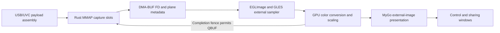

# DMA-BUF feasibility study

Date: 2026-11-07. Application revision: `276edec`. Renderer dependency: MyGo `v0.8.1`.

This document records the feasibility probe against revision `276edec`. The integrated implementation is described in [Architecture and memory ownership](architecture.md#dma-buf-backend); repeatable performance checks are in the [benchmark guide](benchmark-video.md). Statements below about proposed work describe the probe baseline.

## Finding

The connected AVerMedia Live Gamer Ultra 2.1 can export its 4K NV12 capture buffers and the installed NVIDIA driver can import and sample them on the GPU. An actual-device probe completed `MMAP → EXPBUF → EGLImage → GLES external texture → RGBA framebuffer` without first copying the captured frame into a CPU RGBA buffer or issuing a `glTexSubImage2D` upload.

Product integration requires a MyGo rendering extension and a GPU-completion-aware capture lease. The current `ui.Bitmap` API accepts CPU images and cannot present a DMA-BUF descriptor directly. The recommended first implementation is an optional NV12 SDR path with the existing CPU renderer as fallback. Sustained throughput, color accuracy, and end-to-end latency remain unmeasured.

## Verified environment and experiment

| Item | Observed result |
| --- | --- |
| Capture device | AVerMedia Live Gamer Ultra 2.1, USB `07ca:2553`, `/dev/video0`, 10 Gbit/s connection |
| Kernel and media driver | `7.3.1-arare-workstation-bore-llvm-v1`, `uvcvideo`, `vb2_vmalloc_memops` |
| GPU and graphics stack | GeForce RTX 5080, NVIDIA `615.78.08`, Wayland, EGL 1.5, GLES 3.2 |
| Actual format | NV12 3840 × 2160, 60 fps configured, stride 3840, allocation size 12,441,600 bytes |
| Capture allocation | Three MMAP buffers; `VIDIOC_REQBUFS` capabilities `0x17` |
| DMA-BUF export | Three successful `VIDIOC_EXPBUF` calls |
| EGL import | Three successful EGLImages with explicit linear modifier; the same FD supplies Y and UV planes with offsets 0 and 8,294,400 |
| GPU sampling | One dequeued capture frame sampled with `samplerExternalOES` into a 32 × 32 RGBA FBO; readback completed with no GL error |
| Cleanup | STREAMOFF, image/context destruction, exported FD closure, REQBUFS(0), and original format reset completed |

The output checksum was `92cea1d6ec52acd11f2ff2cf72100b00123ad517b566b949944d5e5dff801249`. The probe saved a checksum rather than a screen image. Readback contained only three distinct byte values, so this sample does not establish content fidelity or color accuracy. The probe used blocking readback and `glFinish` to make a bounded experiment; those operations are not the proposed production synchronization strategy.

The viewer was reopened after the test. The restored device format was checked as NV12 3840 × 2160 at 60 fps. The relaunched application has a new UI session; capture settings were not automatically replayed.

### GPU format query

The Wayland EGL display advertised 54 DMA-BUF formats. These are capability-query results, not successful capture-import tests for every format.

| Format | Linear modifier query | Actual capture-to-GPU test |
| --- | --- | --- |
| NV12 | Supported, `external_only=true` | Passed at 3840 × 2160 |
| UYVY | Supported, `external_only=true` | Not run |
| P010 | Supported, `external_only=true` | Not run |
| R8 / RG88 / R16 / RG32 | Supported, `external_only=true` | Plane reinterpretation not tested |
| YUYV | Not advertised by this EGL display | Not run |
| MJPEG | Compressed packet data requires decoding before image import | Not run |

An `external_only` combination requires the external texture path rather than an ordinary 2D sampler. Desktop GL on this system did not expose `GL_OES_EGL_image_external`; GLES did. The current MyGo desktop-GL-first selection therefore needs an explicit compatible video-rendering path. [EGL modifier queries](https://registry.khronos.org/EGL/extensions/EXT/EGL_EXT_image_dma_buf_import_modifiers.txt), [external texture specification](https://registry.khronos.org/OpenGL/extensions/OES/OES_EGL_image_external.txt).

## Existing capture and rendering path

The current application processes frames through:

```text
USB URB payload → UVC video buffer → Rust swscale/decode → Rust RGBA pool
→ Go borrowed RGBA image → MyGo CPU downsampling when needed → GL texture upload
```

| Component | Current behavior and source reference |
| --- | --- |
| Rust capture | `src/rust/src/capture/infrastructure/v4l2.rs`: creates the converter, allocates MMAP buffers, converts a dequeued buffer, and requeues it after CPU conversion. |
| Native frame ABI | `src/abi/rust_core.h`: exposes an RGBA pointer, byte length, dimensions, and lease token; no plane descriptors, DMA-BUF FDs, modifiers, or GPU fences. |
| Go presenter | `src/internal/session/infrastructure/native/bridge_linux.go` and `src/internal/desktop/presentation/app.go`: wrap native RGBA and update a shared Bitmap before releasing the previous frame. |
| MyGo image representation | `ui/bitmap.go:143` and `internal/scene/scene.go:454`: CPU pixel storage without a public external-image representation. |
| MyGo GPU upload | `internal/gpu/gl/gl.go:530`: renderer-local image cache and `glTexSubImage2D` on pixel version changes. |
| MyGo scaling | `ui/paint.go:1651` and `ui/bitmap.go:256`: smaller viewports can regenerate CPU downsample levels before upload. |
| MyGo window contexts | `ui/gpu_linux.go:14`, `internal/linux/surface.go:1179`: separate renderer/cache per window, running with the corresponding GtkGLArea context current. |

MyGo paths refer to the installed `github.com/egoist/mygo@v0.8.1` module. Its public custom shader image inputs are also Bitmaps (`ui/material.go:87`); custom shader code alone cannot supply an external FD. `Window.NativeHandle()` and `RunOnMain` could support a separately managed native GtkGLArea, but that would require separate layout, clipping, context recovery, and window-lifetime integration. An explicit external-image API in MyGo is the preferred maintainable extension.

### Driver constraints

The active kernel source tree is `/mnt/HDD0/workspace/system/kernel/zeroday0619/cachyos-7.3.1-1`. Its generated `uvcvideo` source version matches the loaded module: `CDCB1BF9973BA71B9F9C978`.

- `drivers/media/usb/uvc/uvc_queue.c:246` configures MMAP, USERPTR, and DMA-BUF import with `vb2_vmalloc_memops`.
- `drivers/media/usb/uvc/uvc_v4l2.c:1263` registers the export ioctl.
- `drivers/media/common/videobuf2/videobuf2-vmalloc.c:336` exports the existing allocation; `:368` requires CPU vmap for imported buffers.
- `drivers/media/usb/uvc/uvc_video.c:1339` and `:1375` copy USB payload data into video buffers with CPU `memcpy`.

DMA-BUF consequently does not remove this UVC driver's USB payload assembly copy. It can remove subsequent application-side color conversion, RGBA staging, and pixel-upload calls. A discrete GPU driver can still perform internal staging or memory transfers; the successful import does not prove direct capture-card DMA into GPU VRAM.

MMAP export and DMA-BUF import into V4L2 are separate APIs. This experiment kept `V4L2_MEMORY_MMAP` and exported each allocation with `VIDIOC_EXPBUF`. Switching capture to `V4L2_MEMORY_DMABUF` would supply externally allocated buffers and was not tested. [V4L2 export API](https://docs.kernel.org/userspace-api/media/v4l/vidioc-expbuf.html), [V4L2 import API](https://docs.kernel.org/userspace-api/media/v4l/dmabuf.html).

## Recommended integration



The capture-to-GPU portion was probed successfully. The MyGo integration and sustained lifecycle in this diagram are proposed work.

| Owner | Required change |
| --- | --- |
| Rust media core | Own exported `OwnedFd` values, capture slots, state transitions, and requeue operations. Add a separate DMA frame descriptor ABI while retaining the CPU frame API. GPU import/conversion routines can remain Rust-owned if Go invokes them only with the correct render context current. |
| Swift session control | Select the negotiated path, forward descriptors and session generation, manage restart/fallback policy, and preserve stopped/error states. |
| Go and MyGo | Add an explicit external-image/scene interface and render-context callbacks. Perform import, conversion, presentation, and destruction on the appropriate graphics thread. Bypass CPU Bitmap downsampling for this path. |

The descriptor needs an ABI version and size, dimensions, DRM FourCC, plane FD/offset/pitch, modifier, color metadata, sequence, timestamp, session generation, and opaque lease. V4L2 and DRM format codes must be mapped explicitly. FD ownership must be stated; EGL does not take over the application's FD close responsibility. Color-space and sample-range attributes are hints, so limited/full-range controls require reference-image comparison. [EGL DMA-BUF import contract](https://registry.khronos.org/EGL/extensions/EXT/EGL_EXT_image_dma_buf_import.txt).

For the first implementation, import NV12 and render it into a GPU-owned RGBA texture in a compatible GLES context, then let MyGo composite that texture. This retains one GPU color-conversion/output pass but avoids the CPU RGBA path. Each window's renderer must own or import resources for its own context; sharing the CPU Bitmap today does not establish cross-window GL texture sharing.

For this machine, expose an explicit GLES 3 selection for the relevant MyGo GtkGLAreas rather than relying on its desktop-GL-first fallback. Import, NV12 conversion, and ordinary MyGo composition can then run in the same renderer context. Apply that selection to both windows and keep their import/output caches separate. Passing an ordinary GL texture name between unrelated contexts is not a substitute for a defined sharing mechanism.

### Lifetime and synchronization

A DMA-BUF FD keeps storage allocated; it does not prevent the capture driver from overwriting a requeued slot. The required state transition is:

```text
Queued → DQBUF → GPU reading → GPU completion → QBUF
```

The current CPU frame release timing cannot be reused unchanged. Requeue only after all GPU readers of the capture slot have completed. Convert promptly into GPU-owned presentation storage so window redraws do not keep capture buffers pinned. Release unpublished frames, bound pending work, and handle minimized/closed windows without waiting for a consumer that will never render.

Use GPU fences and renderer completion callbacks or native fence FDs. Do not add a per-frame `glFinish` wait to the production hot path. Retire imports by session generation on format changes, disconnects, and context loss. Shutdown must finish outstanding reads before destroying imports, closing FD owners, or returning/reallocating the queue. [GPU fence semantics](https://registry.khronos.org/OpenGL/extensions/ARB/ARB_sync.txt).

If a fallback maps DMA-BUF memory on the CPU, use `DMA_BUF_IOCTL_SYNC` around CPU access. This handles cache coherency and does not replace GPU/V4L2 access synchronization. [DMA-BUF synchronization](https://docs.kernel.org/driver-api/dma-buf.html).

## Expected benefit and remaining validation

At 3840 × 2160, RGBA contains 33,177,600 bytes per frame; NV12 contains 12,441,600. At 60 fps these represent 1.99 GB/s and 0.746 GB/s of logical payload respectively. These arithmetic estimates do not measure actual bus traffic or latency. Small windows currently upload a smaller CPU-generated image level, so a full-resolution RGBA upload saving must not be claimed for every viewport.

The next implementation should be gated by:

1. A MyGo external-image prototype that keeps native UI, resizing, aspect fit, and the sharing window.
2. Sustained 4K60 tests with bounded queue depth and CPU/GPU timing, compared with the existing path at equal viewport sizes.
3. Fence and resource-lifetime tests during repeated stop/restart, resolution changes, window minimization/recreation, context loss, and device removal.
4. Limited/full-range and Rec.601/709 reference patterns, followed by P010 and other raw formats only after NV12 passes. Keep MJPEG on the existing decoder until a separate decoded-surface path is verified.
5. End-to-end input-to-display measurement. A successful import alone does not establish a latency reduction.

No application implementation, MyGo dependency, package configuration, or production dependency was changed during this research. The bounded Python/ctypes probe and raw results were retained as separate research artifacts. Only this document and its index entry were added to the repository.
