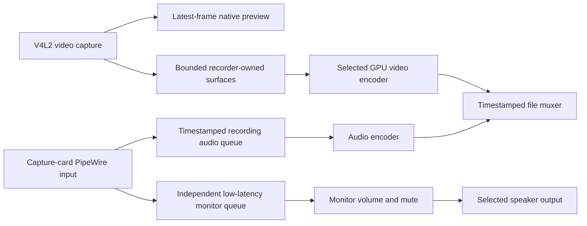

# Hardware-accelerated recording plan

Status: implemented baseline. See [Recording implementation](recording.md) for current behavior and verification boundaries. This plan extends the native MyGo viewer and its separate capture window while preserving capture latency and memory ownership.

## Requested behavior and recommended defaults

- Select a recording GPU and hardware encoder for AV1, HEVC/H.265, or H.264.
- Configure target video bitrate in Mbps, with validated VBR and CBR modes where supported.
- Record the capture card's PipeWire input, which appears among microphone/input devices, and optionally monitor that same input through a selected speaker output.
- Keep Go responsible for native UI, Swift responsible for policy and session transitions, and Rust responsible for media buffers, hardware contexts, encoding, timestamps, and file output.

Recommended defaults are MKV, AAC stereo at 48 kHz and 256 kbit/s, source resolution and rational frame rate, and SDR. MP4 support follows container validation; MKV-to-MP4 remuxing is an alternative for export. Video bitrate defaults require codec-specific quality measurements rather than one value for every codec.

The recommended audio policy records the input level before monitoring gain. Monitor volume, mute, output selection, and monitor-off affect only the speaker branch. This policy follows the approved implementation plan. Selecting an unrelated default microphone is never automatic. Applying a capture preset must not start recording automatically.

## Current evidence

On 2026-11-10, the exposed GPU was an NVIDIA GeForce RTX 5080 at PCI 0000:01:00.0. No Intel or AMD GPU was exposed. Installed FFmpeg 9.0.2 lists NVENC, QSV, VA-API, and AMF encoders for all three requested codecs. Listing an encoder proves build support, not usable hardware or driver support.

Synthetic 1280 × 720 at 60 fps, eight-frame tests passed for H.264, HEVC, and AV1 NVENC on GPU 0. CUDA hardware decoding of each resulting file also passed with CUDA frame output. These tests do not validate 4K60 throughput, long-run reliability, MJPEG hardware decoding, or the application's recording integration. Commands and logs are retained in the task workspace under `outputs/recording-plan/`.

The design required these structural changes, now implemented:

- `src/rust/src/capture/infrastructure/v4l2.rs` drains capture buffers and keeps the newest frame. The DMA path and Go worker also prioritize current preview frames. Recording must receive captured frames before preview-specific discard logic and must not depend on `application.displayedFrame`.
- `src/rust/src/audio/infrastructure/pipewire.rs` combines input and playback ownership. Its monitor ring drops stale backlog and applies gain in playback. A recorder needs an independent input consumer and a timestamped recording queue.
- `src/swift/session/application/CaptureState.swift` owns control transitions; Go's control worker also delivers frames. Encoder initialization, draining, and file finalization must run asynchronously in Rust so a recording command does not block preview delivery.

## Hardware backend policy

| Hardware | Primary Linux encoding path | Decoding path | Device selection |
| --- | --- | --- | --- |
| NVIDIA | FFmpeg NVENC: `av1_nvenc`, `hevc_nvenc`, `h264_nvenc` | NVDEC/CUDA for supported compressed inputs | Stable PCI identity and CUDA device UUID mapped to the current device index |
| Intel | FFmpeg QSV through oneVPL; VA-API as a separately tested alternative | QSV/VA-API where the input format is supported | PCI identity mapped to the selected DRM render node and hardware device context |
| AMD VCE/VCN | FFmpeg VA-API on a supported driver; AMF as an optional additional backend | VA-API; optional AMF only after separate validation | PCI identity mapped to the selected DRM render node; backend-specific mapping for AMF |

Hardware generations differ in codec, profile, bit depth, resolution, and rate-control support. Probe the actual GPU/driver/codec combination. Unsupported combinations remain unavailable with a specific reason; an older VCE/VCN or Quick Sync device must not be advertised as AV1-capable merely because FFmpeg includes an AV1 encoder.

NVDEC decodes compressed input; NVENC encodes output. NV12, P010, packed YUV, and RGB capture do not require decoding. MJPEG hardware decoding is conditional on the GPU, dimensions, and chroma sampling; unsupported inputs retain the existing software decoder. The NVIDIA short probes used H.264/HEVC/AV1 test files and do not establish MJPEG support.

The recording GPU is selected independently of the GTK/MyGo rendering GPU. Auto prefers a compatible device with the least transfer cost. Explicit selection never silently changes to a different adapter. Store stable identity rather than a CUDA ordinal or renderD number alone. Cross-GPU recording uses an explicit, bounded transfer path and exposes that path in diagnostics.

The [NVIDIA FFmpeg guide](https://docs.nvidia.com/video-technologies/video-codec-sdk/13.1/ffmpeg-with-nvidia-gpu/index.html), [Intel media-driver capability tables](https://github.com/intel/media-driver), [AMD AMF documentation](https://github.com/GPUOpen-LibrariesAndSDKs/AMF), and [FFmpeg encoder reference](https://github.com/FFmpeg/FFmpeg/blob/master/doc/encoders.texi) describe the corresponding APIs and capability differences. AMD's documented Linux AMF support is an additional option, not a requirement to replace the VA-API implementation.

## Data flow and ownership

The recorder consumes original capture data before display conversion. It must not encode UI controls, letterboxing, or an eight-bit screenshot of the P010 preview. Preserve source color metadata and significant ten-bit samples for supported HEVC/AV1 profiles. H.264 eight-bit output uses an explicit validated conversion. HDR support is outside this SDR milestone.

Rust owns recording surfaces, packets, hardware contexts, threads, and file descriptors through RAII. Frame counts and byte budgets bound every queue. A capture slot is leased only until the recorder's import or copy has safely completed. Encoder lookahead and frame reordering retain recorder-owned surfaces rather than pinning V4L2 slots indefinitely. All preview and recorder readers must finish before QBUF. GPU completion and failed-submission cleanup preserve the existing fence contract.

DMA-BUF import into the current EGL renderer does not establish import compatibility with CUDA, QSV, or VA-API. Start with a checked staging/upload path into hardware-encoder-owned memory. Add direct mapping only for probed format/modifier/device combinations. Cross-device or unsupported imports retain bounded staging. Hardware encoding must remain active when the transfer path falls back to CPU staging.

PipeWire callbacks only validate bounds and publish into preallocated queues. Encoding, resampling, muxing, disk I/O, waiting, and calls into Swift/Go remain outside realtime callbacks. Recording and monitoring have independent read positions. Disabling monitoring must retain the input stream while recording still needs it; stopping recording must retain it while monitoring still needs it.

## Timing, overload, and lifecycle

Normalize video timestamp domains and PipeWire stream timing into one monotonic recording timeline. Keep rational frame rates such as 60000/1001 exact. Use audio sample counts, stream clock data, and bounded resampling to handle clock drift and discontinuities. PipeWire's [stream time snapshot](https://docs.pipewire.org/structpw__time.html) includes graph ticks, timing rate, buffering, and delay; callback arrival time alone is not an audio timestamp. Preview and monitoring receive no added synchronization wait.

Preview discard and recording overload are separate policies. Short recording video drops retain accurate timestamp gaps and visible counters. Sustained encoder backlog or an audio recording overflow stops and finalizes recording rather than growing memory or delaying preview. Monitoring can continue its existing stale-backlog discard policy. A disk-full, write failure, disconnected source, or lost encoder transitions recording to a reported failure. Finalization is best effort when the filesystem fails; preserve incomplete files without reporting successful completion.

Swift validates configuration and tracks idle, starting, recording, stopping/finalizing, completed, and failed states. Rust workers perform initialization and draining asynchronously. Recording stop leaves preview and monitoring active. Changing video device/mode or audio input during recording is locked; stopping video first requests recording finalization. Monitor volume/mute/output may change independently. Closing the application waits for owned recording work to stop safely and reports finalization errors.

Create output files without overwriting existing recordings. Surface counts, packet sizes, file counters, timestamp rescaling, and all FFI lengths use checked arithmetic. Preserve the temporary/incomplete file until successful finalization permits its final name.

## Native UI and preset integration

Category navigation switches to a native selector when the available width cannot fit all settings tabs. Add a Recording settings page containing GPU, available encoder/backend, codec, bitrate and rate control, output path/container, and Record audio. Existing audio-device selection identifies the capture-card input; monitoring has its own enable control, speaker output, volume, and mute. Show an audio level meter that identifies the recorded input separately from monitor gain.

The command bar exposes Start recording and Stop recording with duration, file size, dropped frames, and errors. Recording initialization/finalization status must not freeze the UI or capture worker. Unavailable GPU/codec combinations show their reason before recording begins.

Swift owns `RecordingPolicy` and resolved configuration. Rust owns a `RecordingSession`, adapters, video/audio encoders, muxer, timeline, and bounded queues. Go owns only controls and projections. New ABI entry points use opaque handles, explicit ownership, version checks, and typed status. Extend saved presets with recording configuration through a versioned migration; existing presets load with recording disabled. Preserve older documents and reject unsupported future versions safely.

## Implementation stages and completion gates

| Stage | Work | Completion gate |
| --- | --- | --- |
| 1. Input and ownership foundation | Define configuration/ABI/status contracts, split audio input from monitoring, add timestamped video/audio recorder taps before preview discard, introduce bounded recorder buffers and lifecycle state | Original preview/audio ownership tests pass; independent monitor mute/off works; stalled recording consumers cannot block capture or grow queues |
| 2. NVIDIA recording baseline | NV12 SDR, NVENC H.264, AAC, MKV, target bitrate, asynchronous start/stop, error propagation and finalization | A real capture-card file decodes with both tracks, correct dimensions/rational timing and usable audio; stop/start and shutdown release all owners |
| 3. Hardware and format coverage | AV1/HEVC, conditional NVDEC compressed-input decoding, Intel QSV, AMD VA-API, optional AMF, stable GPU selection, P010 and other supported capture conversions, probed direct-import optimization | Each available GPU/codec/profile passes actual encoding; cross-GPU and staging paths are explicit; unsupported combinations fail before recording starts; Intel/AMD hardware tests remain pending until devices are available |
| 4. MyGo UI and saved presets | Recording controls/status, input versus monitor behavior, GPU/codec capability feedback, bitrate/path/container settings, safe preset migration | Native GUI tests cover overview/detail navigation, record/stop, monitoring independence, missing adapters, presets, compact/fullscreen layouts, and the separate capture window |
| 5. Reliability and performance | Long recordings, A/V drift, all encoder paths, storage failure, GPU/source loss, repeated lifecycle, ASan/TSan/LSan, Debian packaging checks | On verified hardware, record 4K60 with both preview windows while comparing a no-recording baseline; bounded memory, no sanitizer findings, valid files, and documented failures; other hardware is not labeled verified without its own evidence |

Proposed performance targets are at least 59 measured texture updates/s in each preview window at a 60 Hz test mode, with no recording-induced frame backlog, and no more than 2 ms additional p95 capture-to-texture-ready delay in repeated controlled comparisons. These are acceptance targets, not measured recording results. For a supported configuration and sufficiently fast disk, a one-hour test should have no sustained encoder overload and less than one frame of accumulated container-timeline A/V drift. Source hardware A/V offset and physical display latency require separate measurements.

## Dependencies and scope

Continue using the existing Rust-to-FFmpeg bindings. File muxing and audio resampling are expected to add direct use of libavformat and libswresample; their development libraries are installed on the current host. These named additions were included in the approved implementation plan. Hardware driver runtimes are optional, detected per backend. This plan does not add a CUDA toolkit build, vendor SDK source trees, a WebView, or C/C++ implementation files.

The implementation adds no Rust crate, CUDA toolkit build, or C implementation source. Intel/AMD hardware validation, direct encoder DMA-BUF import, and physical A/V latency measurements remain outside the verified baseline.
